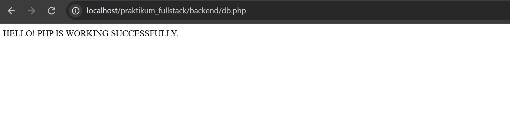
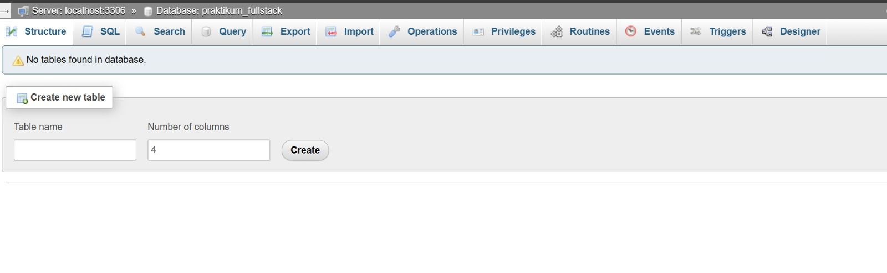
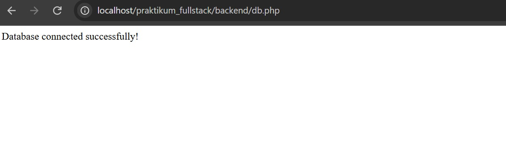
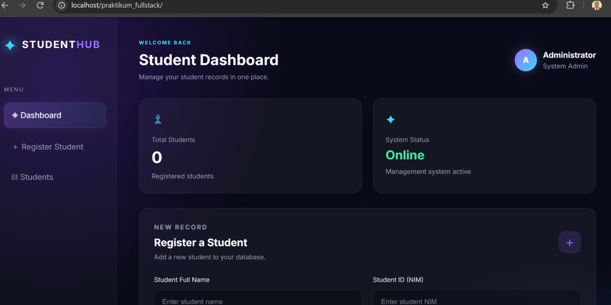
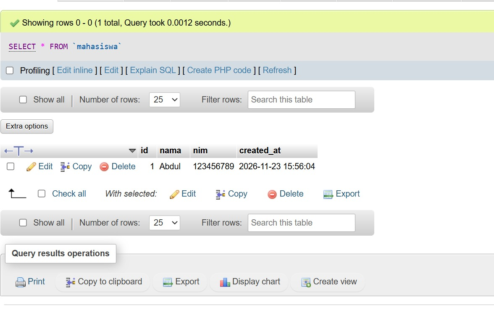
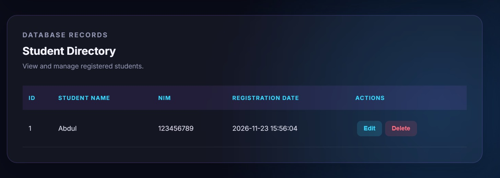
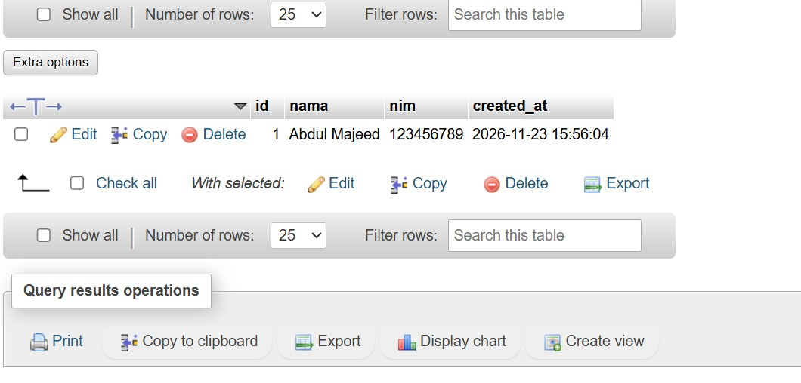
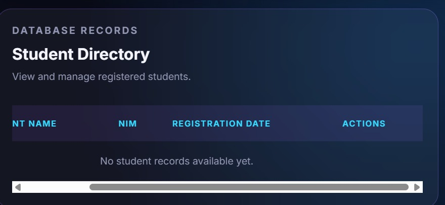

# STUDENTHUB – Student Management System

## Project Description

STUDENTHUB is a simple fullstack web application developed as part of Praktikum 7 – PHP.

The application allows users to register, view, update and delete student information using a MySQL database.

## Technologies Used

- HTML5
- CSS3
- JavaScript
- PHP 8.2
- MySQL
- Laragon
- phpMyAdmin

## Project Structure

```text
praktikum_fullstack/
│
├── backend/
│   ├── db.php
│   ├── create.php
│   ├── read.php
│   ├── update.php
│   └── delete.php
│
├── index.html
├── style.css
├── script.js
└── README.md
```

## Main Features

- Register student information.
- Display student records.
- Update student information.
- Delete student records.
- Automatic student record counting.

## Database Configuration

Create a MySQL database named `praktikum_fullstack`.

Create a table named `mahasiswa` with the following columns:

- id
- nama
- nim
- created_at

Configure your local database credentials in `backend/db.php`.

## How to Run

1. Install Laragon.
2. Start Apache and MySQL.
3. Place the project inside Laragon's `www` directory.
4. Create the required database and table.
5. Configure the database connection.
6. Open your browser and visit:

`http://localhost/praktikum_fullstack/`

## Academic Information

Praktikum 7 – PHP  
Information Technology Program  
Faculty of Science and Technology  
Universitas 'Aisyiyah Yogyakarta

## Application Screenshots

The following screenshots demonstrate the implementation and functionality of the STUDENTHUB Student Management System.

### 1. PHP Environment

PHP was successfully executed using the Laragon local development environment.



### 2. Database Configuration

The MySQL database was created using phpMyAdmin.



### 3. Database Connection

The PHP backend successfully established a connection with the MySQL database.



### 4. Student Management Dashboard

The application features a modern glassmorphism interface with dashboard statistics and student registration functionality.



### 5. Student Registration

Student information can be submitted through the registration form.



### 6. Student Records

Registered student information is retrieved from MySQL and displayed dynamically in the student directory.



### 7. Update Student Information

The application allows existing student records to be modified.



### 8. Delete Student Information

The application supports deleting student records from the database.



## Developer

Abdul Majeed
